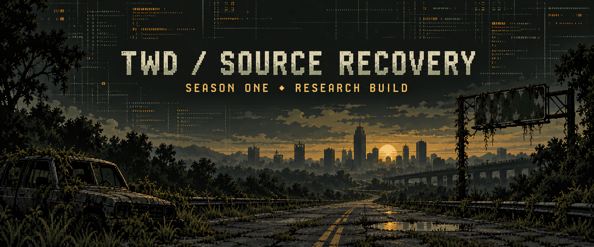

# The Walking Dead: Season One — source recovery

Reconstructed C++, reverse-engineering tools and measured progress for the Windows x86 game. The public repository contains the replacement source and research tooling. Game binaries, assets, bulk decompiler listings and machine-code test fixtures stay in the local research workspace.

[Progress](docs/PROGRESS.md) · [Timeline](docs/ROADMAP.md) · [Build and local inputs](docs/LOCAL_RESEARCH.md) · [Runtime evidence](reports/current-runtime-acceptance.json)

**Status: an experimental hybrid runs. A standalone source-only engine is unfinished.**

## Progress

Snapshot: **2 November 2026**.

| Track | Measured result | Status |
| --- | ---: | --- |
| Installed archive indexes | 134 / 134 | **100% of surveyed archives** |
| Discovered Lua variants | 622 / 622 recovered and syntax-checked | **100% of discovered variants** |
| Recognized native function exports | 18,299 / 18,299 | **100% of the current catalog** |
| Native functions replaced with C++ | 14 / 18,299 | **0.077% by function count** |
| Remaining original-code functions | 18,285 | Source reconstruction pending |
| Complete source engine / campaign parity | Not established | No completion percentage assigned |

Function count is not an estimate of effort. The fourteen replacements are small compared with the unresolved engine subsystems. The export percentage describes reference output, not a buildable game. [Metric definitions and limitations →](docs/PROGRESS.md)

## What works

- **14 compiled native replacements:** segment geometry, four hash routines and nine Symbol operations.
- **3,932,574 original/replacement comparisons:** static and DLL modes, zero failures in the recorded runs.
- **71,215,162 source-entry calls** observed during a bounded hybrid runtime test.
- **Opening-scene save/reload:** a serialized marker survived reload, followed by 17,700 observed scene frames and no unhandled exception during the 100-second test.
- **Preserved analysis:** function catalog, corrected hash signatures, RTTI evidence and an audit of 111,240 direct calls in the local research workspace.

The tested scene is `adv_streetoutskirts.scene`. Seven of the fourteen replacement entry points were observed in that run; the others have differential-harness coverage. Full chapter progression, campaign equivalence and a platform port remain unverified.

## Build the published source

Windows prerequisites: **CMake 3.24+** and **Visual Studio 2022 C++ build tools**.

```powershell
cmake --preset vs2022-x86 -DTWD_BUILD_CAPTURE_TESTS=OFF
cmake --build --preset x86-release --parallel
ctest --preset x86-release --output-on-failure
```

This builds the replacement library, x86 DLL, image utility and public contract tests. It does not create a standalone game or fetch game content. The public contract tests contain no captured game instructions.

Open `decomptwdgame1season.code-workspace` in VS Code, or the generated `build/x86/TWDSeasonOneRecovery.sln` in Visual Studio. The public VS Code tasks configure, build and test the source.

The stronger differential suites require locally generated `tests/original_*.hpp` fixtures and the matching analysis image. Runtime experiments also require the separate local game assets and prepared executable. [Local-input workflow →](docs/LOCAL_RESEARCH.md)

## Timeline

**A full source-only rebuild has no defensible delivery date. For solo planning, treat it as a potentially multi-year project.** That is a low-confidence planning judgment, not a measured ETA.

| Milestone | State | Next acceptance requirement |
| --- | --- | --- |
| Reference recovery | Recorded | Keep the catalog tied to the exact input build |
| Geometry and hash/symbol source | Tested | Expand into ownership and allocation |
| Hybrid scene and save/reload | Tested in one scene | Controlled input-driven progression and a second state |
| Resource/object lifecycle | Next investigation | Original/replacement create–use–free parity |
| Full source engine | Unscheduled | Run without captured original engine machine code |
| Port and full campaign regression | Unscheduled | Platform and gameplay acceptance |

The next proposed investigation is a **16–40 focused-hour timebox** for String32 allocation and ownership. It is a budget for learning and a bounded experiment, not a promise to finish a subsystem in five days. Larger estimates should follow measured resource-lifecycle work. [Detailed roadmap →](docs/ROADMAP.md)

## Repository map

| Path | Contents |
| --- | --- |
| `reconstructed/` | Compilable C++ replacements and x86 ABI bridges |
| `tests/source_contracts.cpp` | Public tests without game data |
| `tests/*_differential.cpp` | Harness source; original-code fixtures are generated locally |
| `scripts/` | Selected analysis, fixture and hybrid-build tools |
| `tools/image_rebuild.cpp` | Hash-checked image-reconstruction utility |
| `re/replacements.json` | Exact replacement RVAs, expected prefixes and source mapping |
| `docs/function-catalog.csv` | Names/RVAs/status metadata; no decompiled function bodies |
| `docs/progress.json` | Machine-readable progress snapshot |
| `reports/` | Selected measured results with workstation paths sanitized |

## Evidence and limits

The work targets one exact native x86 build. The prior memory capture was checked for build consistency; its original process/page-read provenance is incomplete. Decompiler output can be wrong even when export succeeds. One corrected 64-bit return type restored an entire CRC64 calculation missing from an earlier listing.

The unresolved signed-buffer CRC64 routine at RVA `0x1eec10` is not replaced: high-byte input can read preceding relocated data. The implementation preserves known behavior instead of substituting a conventional checksum without evidence.

The x64 configuration builds a library/tool subset. It is not an x64 game port. The current hybrid still uses original machine code, original game assets and its platform integrations.

This is an independent research project. The game and its third-party components retain their respective ownership. The cover is an original generated illustration, not a game screenshot; [artwork provenance](docs/ASSETS.md).
